# テクスチャ設定でテクスチャーメモリを削減する

:::warning
TextureConfigurator は実験的なコンポーネントです！予告なく機能変更や削除がされる可能性があります。
:::

VRAM の使用量を削減したいよね！！！ (決めつけ)

テクスチャのサイズを落としたり圧縮設定を変えるというのをよく VRAM 削減の手段としてよくあるけど〜 ...

lilAvatarUtils とかを使っても使わなくても、 __テクスチャのインポート設定を直接いじっちゃうと__ ...

__プロジェクト全体に影響する破壊的な変更__ になっちゃうから〜それはしたくないよね〜！

したくないよね ！ (決めつけ)

## チュートリアル

:::note
このチュートリアルのスクリーンショットは Unity 6.4 のバージョンでかつ、Linux 版 UnityEditor で撮影されているため細々とした部分に差異が見られます。気にしないでください。
(また、現時点では Unity 6.4 は VRC のアバター改変環境としては適切ではないため、真似しないでください。)
:::

アバタールートを右クリックしてから、 TexTransTool/Other/TTT TextureConfigurator を選択！

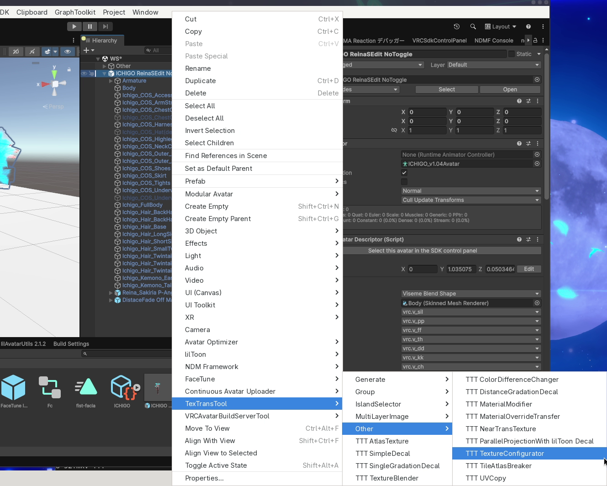

こんな感じのものが生成されます！

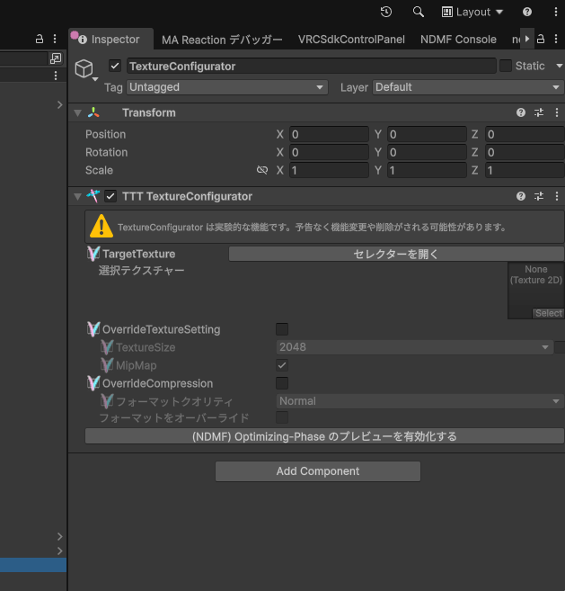

次に、どのテクスチャの設定をいじるかを決めましょう。

「セレクターを開く」から選択してもよいですし

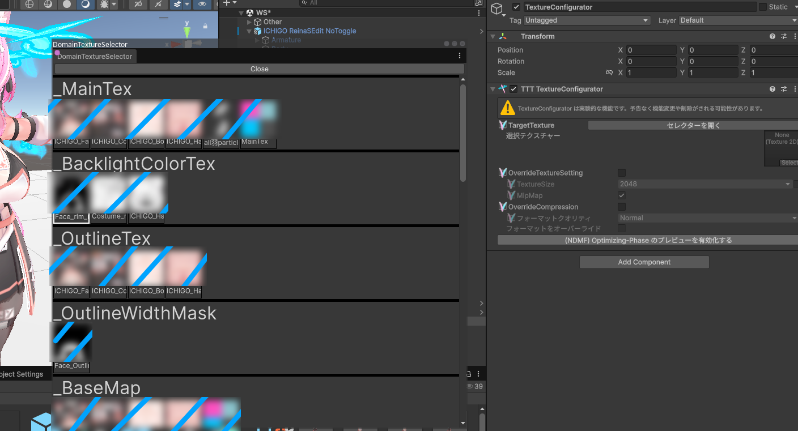

どのテクスチャかわかっているならば、ここに直接 D&D してもよいですね！

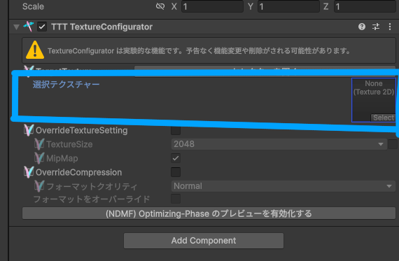

テクスチャ設定をいじりたいテクスチャを選ぶ(割り当てる)ことが出来たら、

「OverrideTextureSetting」(テクスチャ設定をオーバーライドする) か「OverrideCompression」(圧縮設定をオーバーライドする) のいじりたい方のどちらかもしくは両方を有効化しましょう！

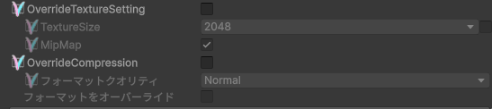

「OverrideTextureSetting」を有効化すると「TextureSize」テクスチャの解像度(サイズ) と 「MipMap」(ミップマップの有無)　を変更することが可能になります。

既存の状態が 2048 だった場合、 1024 などに「TextureSize」などを設定すると、見た目と引き換えに VRAM 使用量を大きく削減することが出来ますね！

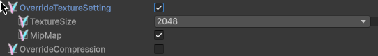

:::warning
MipMap の設定、それについてよく理解していない場合は触らないでください。 MipMap が本当に不要なケースというのはあまり多くなく、シェーダーに対する高度な知識がないと判別できません。

何もわからないのであれば、手を触れず、有効なままにしておきましょう。
:::

:::note
TextureSize は、設定値を大きくすると逆に VRAM 容量が増加し、もともとのテクスチャ(PNG)の解像度までは見栄えが良くなる可能性があります。

解像度を上げる時は、別アバターとして高解像度にするなど、限られた状態で、そのアバターを使うタイミングも人数が控えめなときなど、節度を持って使用してくださいね。
:::

「OverrideCompression」を有効化すると、「フォーマットクオリティ」を選ぶことが出来、「Low」「Normal」「High」などを選ぶことが可能で、高品質な圧縮にしたりしなかったり出来ます。

既存の設定が「High」だった場合「Normal」や「Low」を選ぶことで容量を削ることが出来ますね！

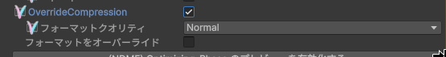

:::warning
「フォーマットクオリティ」は「None」も選択可能ですが、それが本当に「None」である必要がある場合はシェーダーと密接に関わるテクスチャなどであり、通常は絶対に使用する必要がありません。

あなたが、シェーダーについて完全に理解している人ではない、技術者ではないのであるならば、絶対に「None」を選ばないでください。

「None」という選択肢は、非圧縮という最高品質が得られる代わりに、あまりにも多くの VRAM 容量を使用する選択肢です。 容量が足りたとしても RTX4060 のような VRAM 帯域が狭い GPU が泣きます。やめてあげましょう。

(基本的に) 選ばないでください。
:::
:::tip
「フォーマットをオーバーライド」などの設定について詳細を知りたい場合はここを[参考](/docs/Reference/AtlasTexture/TextureFineTuning#compress)にしてください。
:::

このチュートリアルの場合、選んだテクスチャは解像度が「2048」で圧縮設定が「NormalQuality」なので

「TextureSize」テクスチャの解像度(サイズ) を「1024」に設定し「フォーマットクオリティ」を「High」にして、解像度抑えながら圧縮設定を上げることで、VRAM 使用量を削減しながらある程度品質を保つ設定にしてみました。

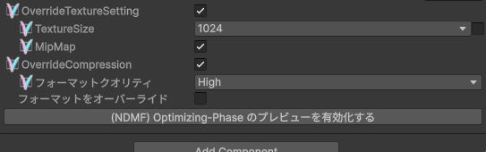

:::tip
VRAM の使用量は、概ね テクスチャの解像度(サイズ) と 圧縮設定 で定まります。

解像度は「1024」から「2048」など1段階上げて大きくすると容量は 4倍 、小さくすると 1/4 になり  
PC 向けの場合は圧縮設定を「Normal」から「High」の間で容量が高くすると 2倍、 低くすると 1/2 になります。

今回の設定の場合、解像度を下げて 1/4 にした後、圧縮設定を上げて 2倍 にしているので最終的には VRAM の使用量は元の半分になります。

解像度と圧縮設定は、それぞれ違った品質絵の影響を及ぼします。うまく調整してみてね。
:::

最後に！

設定できたら `Manual Bake Avatar` か UnityEditor を再生し、ビルドしてみましょう！

ビルド後のテクスチャを漁ると確認することができ、今回のチュートリアルの設定ではこのような感じに、1024x1024 となり、High にしたので圧縮が BC7 になって、正常に反映されていますね！

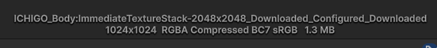

:::warning
NDMF Preview などのプレビューでは、基本的に圧縮設定が正しく反映されない。または、全くプレビューされないので、確認する時は、上記手順などを使用し、完全なビルドを行った結果を確認してください。
:::

## たくさんのテクスチャの設定変更

上記の手順を1つづつ行ってたくさんの対象を変更することも出来ますが、TextureConfigurator を一気に生成し、たくさんのテクスチャに細かく設定を施すことが出来ます！

アバタールートを右クリックしてから、 TexTransTool/Generate/TTT TextureConfigurator を選択！

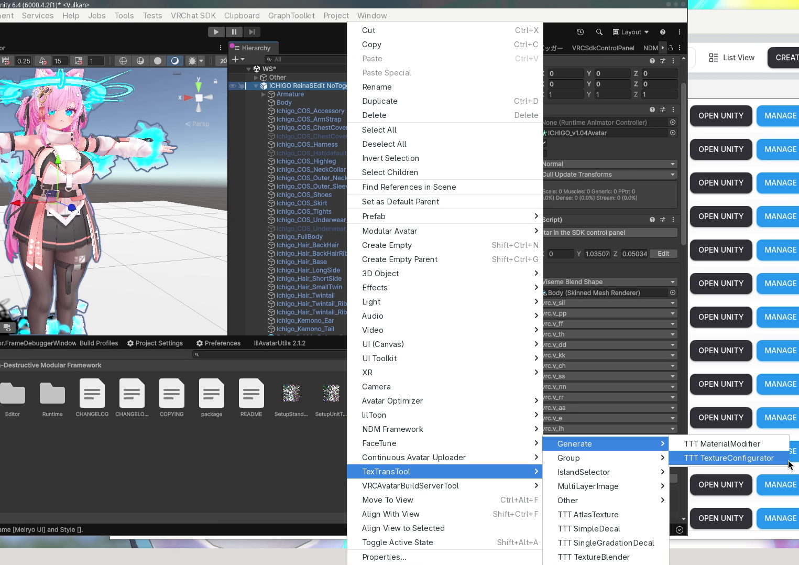

選択すると、こんなかんじに、たくさんの無効化された TextureConfigurator を生成させることが出来ます。

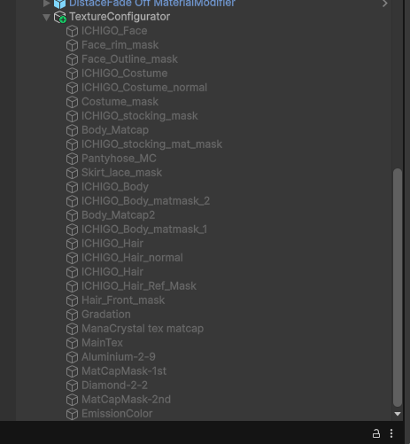

必要に応じて GameObject を有効化することで、TextureConfigurator の無効化を解き、設定しましょう！

### もっと全部適当に設定していい感じに VRAM を削減してほしい

そんな 自動設定、便利・かんたん機能 は TexTransTool にはありません。

おそらくあなたがお求めは、[LAC: Avatar Compressor](https://lac.limitex.dev/ja/) だと思います。

LAC は、一括でテクスチャの内容を見ながら、いい感じに圧縮してくれます。 かんたん をお求めならこっちのほうが良いかも。

:::info
LAC はこのチュートリアル書いている時点では、TTT よりも先に動作するので、おそらく TextureConfigurator が存在した場合は、その設定値が最終的な結果になるでしょう。

ですが、LAC がある場合は LAC の[個別に設定する機能](https://lac.limitex.dev/ja/docs/components/texture-compressor/#%E5%87%8D%E7%B5%90%E3%83%86%E3%82%AF%E3%82%B9%E3%83%81%E3%83%A3)を用いたほうが、設定が見やすくなるし、混乱をのもとを減らせるのでその場合は LAC の方の機能を活用することをおすすめします。
:::

## クレジット

- はみにの立体箱/イチゴ : https://hamini.booth.pm/items/7328789
